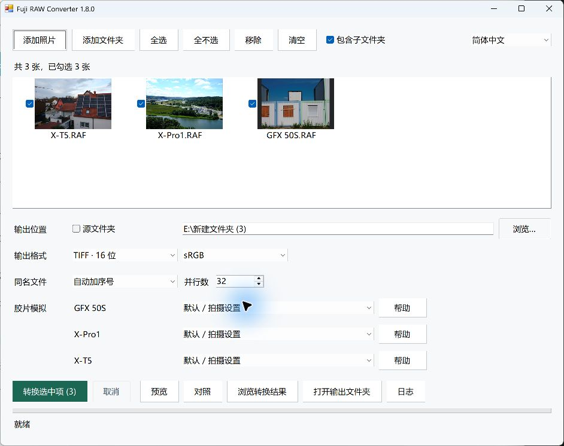
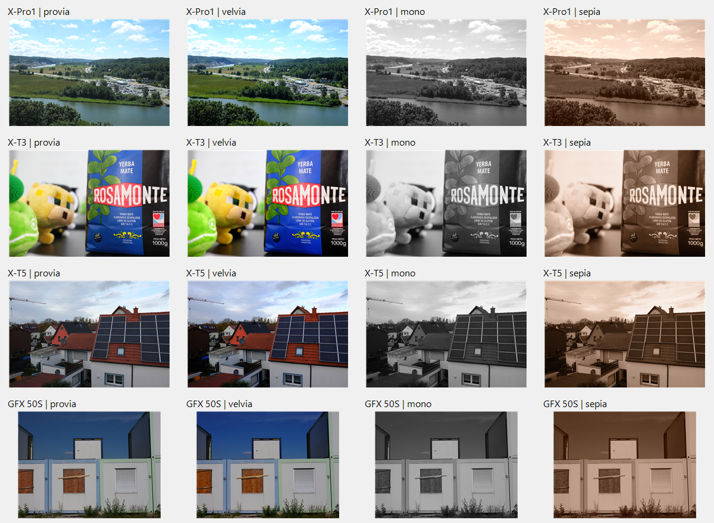

# Fuji RAW Converter

**A Windows batch interface for Fujifilm's official RAW conversion components.**

Import RAF photos, choose film simulations for each camera model, export JPEG or TIFF, and browse or compare the results. Supports FinePix S3 Pro, S5 Pro, and multiple generations of X-series and GFX cameras.

RAW decoding, development and film rendering use the conversion components supplied with Fujifilm's official software: Fujifilm's native engines for early cameras such as the S3/S5, and **RAW FILE CONVERTER EX 3.0 powered by SILKYPIX** for X/GFX. This project provides the interface, parameter integration, batch scheduling and file export. JPEG encoding uses Windows imaging components.

[Download the Windows portable package](https://github.com/Eyre5300/Fuji-RAW-Converter/releases/latest) · [简体中文](README.md) · [Camera and film list](docs/CAMERAS.md) · [Illustrated Bilibili guide (Chinese)](https://www.bilibili.com/opus/1266000447263473686)

Current version: **1.8.0**. Download `Fuji-RAW-Converter-1.8.0-Windows.zip` from the release; the **Source code** archives are for developers. Usage instructions and camera tables are maintained here rather than bundled with the portable application.

*An X-T5, X-Pro1 and GFX 50S batch with separate film selections for each camera.*

## Focused on batch conversion

The official software provides many adjustment tools and panels, which can make a simple batch export cumbersome. Fuji RAW Converter brings photo selection, film simulation, format and output location into one window for a conversion-focused workflow.

Multiple independent conversion processes run in parallel to reduce serial waiting and use multiple CPU cores. The concurrency setting defaults to the logical processor count and can be changed manually. Each batch starts with one task to measure memory usage, then adjusts concurrency to available memory. When memory and disk throughput permit, this can improve CPU utilization and batch throughput. Actual speed depends on the camera files, output format and hardware.

## Getting started

Requires 64-bit Windows and .NET Framework 4.8.

1. Extract the complete Windows ZIP and launch `Fuji-RAW-Converter.exe`. Keep the adjacent `data` folder.
2. Add RAF files or folders and select the photos to convert.
3. Choose the output folder, JPEG or TIFF, and a film simulation for each camera model.
4. Click **Convert selected**. Open the results in the viewer or use **Compare** to view source and output together.

The complete portable package needs no separate converter installation or connected camera. Source RAF files remain read-only. Existing output names receive a numeric suffix by default; skip, error and overwrite options are also available. The interface supports English and Simplified Chinese.

## Cameras and film simulations

| Camera | Film choices |
|---|---|
| FinePix S5 Pro | Standard, F1, F1a, F1b, F1c, F2 |
| FinePix S3 Pro | Standard, F1, F2; F1/F2 use sRGB |
| X-series and GFX | Model-specific PROVIA, Velvia, ASTIA, PRO Neg., Classic Chrome, ACROS, ETERNA and other modes |
| Newer cameras with the corresponding modes | Classic Neg., ETERNA Bleach Bypass, Nostalgic Neg., REALA ACE |

The X/GFX film menus cover 59 camera models. Representative models are shown below; see the [complete camera and film list](docs/CAMERAS.md) for all options.

| Representative camera | Film count | Examples (not an exhaustive list) |
|---|---:|---|
| X-Pro1 | 10 | PROVIA, Velvia, ASTIA, PRO Neg., Monochrome, Sepia |
| X-T1 | 11 | Includes Classic Chrome |
| X-T3 | 16 | Includes ACROS and ETERNA |
| GFX 50S | 17 | Includes Classic Neg. and ETERNA |
| X-T5, X-T50 | 20 | Includes Nostalgic Neg. and REALA ACE |

Counts include monochrome filter variants and exclude the additional **Default / As shot** option. The list follows the official conversion components included in this version, including their expanded film options for certain GFX models.

Mixed-camera batches have separate film selections for each model. **Help** describes the available films. **Default / As shot** retains the official component's default processing; choose PROVIA for explicit color rendering. ACROS and Monochrome produce black-and-white images; Sepia produces a brown monochrome image.

*Each row uses the same RAW file. Columns: PROVIA, Velvia, Monochrome, Sepia. Rows: X-Pro1, X-T3, X-T5, GFX 50S. These are reduced previews of official-component exports, with no additional grading. Sample files: [raw.pixls.us](https://raw.pixls.us/) (CC0).*

## Output and batch tools

| Format | Bit depth and color space |
|---|---|
| JPEG | 8-bit sRGB; adjustable quality, default 92 |
| TIFF | 8-bit or native 16-bit per RGB channel; sRGB or Adobe RGB |

Exports use the camera's full development dimensions. Early FinePix cameras use the camera color space for Standard + 8-bit TIFF; available color choices follow the selected files, format and film.

- Batch concurrency follows your configured limit and adjusts to memory usage.
- Browse RAF, JPEG and TIFF files and compare source photos with exports.
- RAW thumbnails use embedded camera previews. View exported images to see the selected film effect.
- The command line supports batches, per-camera film queries and JSON results. See the [developer documentation](docs/DEVELOPMENT.md).

## Conversion components and licensing

This is an independently developed interface, not an application published by Fujifilm. Official conversion components and color resources retain their owners' license terms. MIT applies only to this project's own code. See [LICENSE](LICENSE) and [NOTICE](resources/NOTICE.txt).

Official references: [RAW FILE CONVERTER EX](https://www.fujifilm-x.com/en-us/products/software/raw-file-converter-ex-powered-by-silkypix/) · [Version history](https://www.fujifilm-x.com/en-us/support/download/software/raw-file-converter-ex-powered-by-silkypix/)
