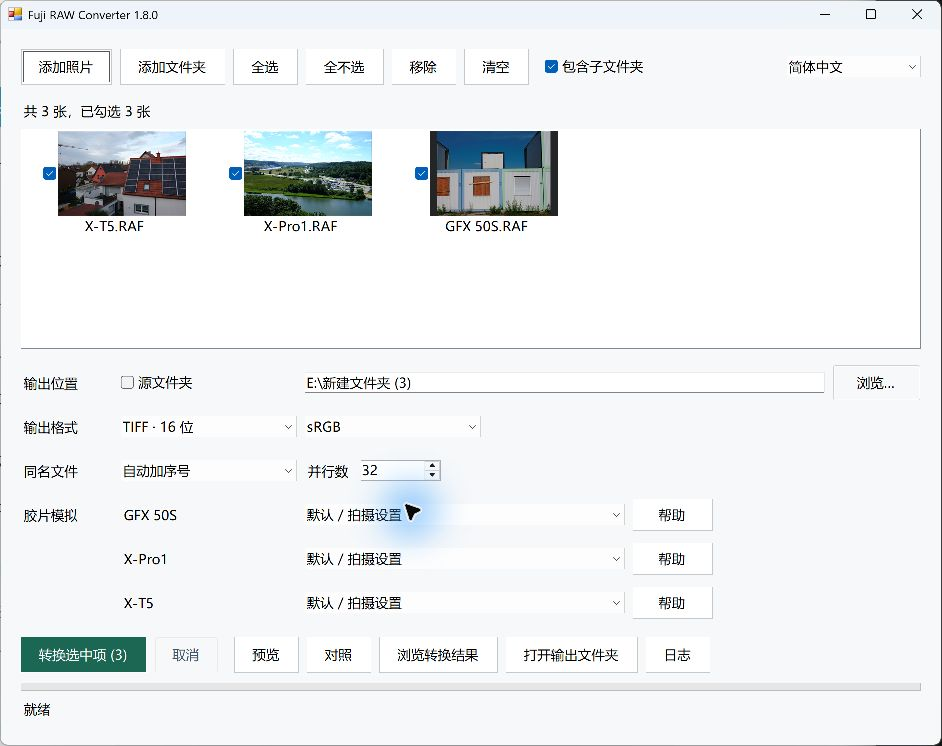
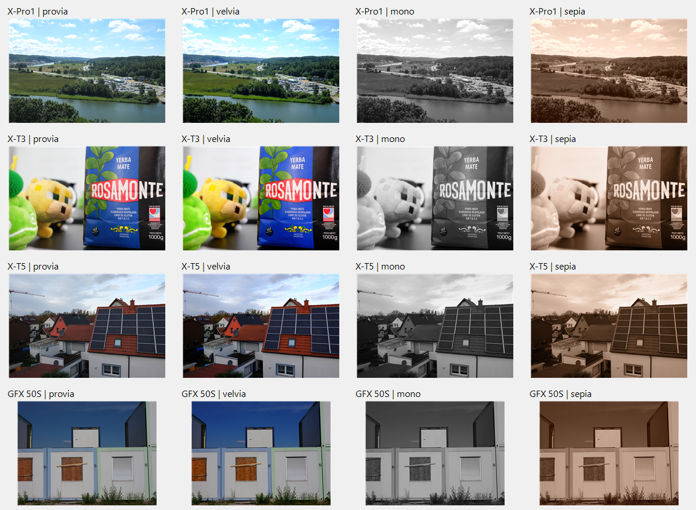

# Fuji RAW Converter

**富士官方 RAW 转换组件的 Windows 批量操作界面。**

导入 RAF 照片，按机型选择胶片模拟，批量导出 JPEG 或 TIFF，并浏览、对照转换结果。支持 FinePix S3 Pro、S5 Pro，以及多代 X 系列和 GFX。

RAW 解码、显影和胶片效果由富士官方软件配套的转换组件完成：S3/S5 等早期机型使用富士原厂转换内核，X/GFX 使用 **RAW FILE CONVERTER EX 3.0 powered by SILKYPIX**。本项目负责界面、参数传递、任务调度和文件导出，JPEG 编码使用 Windows 图像组件。

[下载 Windows 便携包](https://github.com/Eyre5300/Fuji-RAW-Converter/releases/latest) · [English](README.en.md) · [机型与胶片清单](docs/CAMERAS.md) · [B 站图文介绍](https://www.bilibili.com/opus/1266000447263473686)

当前版本：**1.8.0**。下载 Release 中的 `Fuji-RAW-Converter-1.8.0-Windows.zip`；`Source code` 是源码包。便携包不附使用说明，操作步骤和机型表统一在本仓库维护。

*X-T5、X-Pro1 和 GFX 50S 混合导入示例；各机型有独立的胶片选择。*

## 专注批量转换

官方软件包含较多调节功能和面板，只想把一批 RAW 转成图片时，界面和操作步骤显得冗杂。Fuji RAW Converter 将选片、胶片、格式和输出目录集中在一个窗口，适合以转换为主的工作流程。

批量任务使用多个独立转换进程并行运行，减少逐张串行等待，充分利用多核 CPU。默认并行数取逻辑处理器数量，也可以手动设置；每批先运行一个任务测量内存，再根据内存余量调整实际并行数。内存和磁盘条件允许时，可提高 CPU 利用率和批量吞吐量；实际速度取决于机型、输出格式及电脑配置。

## 开始使用

需要 64 位 Windows 和 .NET Framework 4.8。

1. 完整解压 Windows ZIP，双击 `Fuji-RAW-Converter.exe`，保留旁边的 `data` 文件夹。
2. 添加 RAF 照片或文件夹，勾选要转换的照片。
3. 选择输出目录、JPEG 或 TIFF，并在各机型对应的下拉框中选择胶片模拟。
4. 点击“转换选中项”。完成后双击浏览，或使用“对照”查看原片与导出结果。

完整便携包无需另行安装转换软件，也无需连接相机。原始 RAF 保持只读；同名输出默认自动加序号，也可选择跳过、报错或覆盖。界面支持简体中文和 English。

## 机型与胶片模拟

| 机型 | 胶片选择 |
|---|---|
| FinePix S5 Pro | 标准、F1、F1a、F1b、F1c、F2 |
| FinePix S3 Pro | 标准、F1、F2；F1/F2 使用 sRGB |
| X 系列、GFX | 按机型提供对应的 PROVIA、Velvia、ASTIA、PRO Neg.、Classic Chrome、ACROS、ETERNA 等模式 |
| 配备相应模式的新机型 | 另提供 Classic Neg.、ETERNA Bleach Bypass、Nostalgic Neg.、REALA ACE |

X/GFX 的胶片菜单覆盖 59 个机型。以下为部分代表机型，完整对应关系见[机型与胶片清单](docs/CAMERAS.md)。

| 代表机型 | 胶片数量 | 模式示例（非完整列表） |
|---|---:|---|
| X-Pro1 | 10 | PROVIA、Velvia、ASTIA、PRO Neg.、黑白、Sepia |
| X-T1 | 11 | 包含 Classic Chrome |
| X-T3 | 16 | 包含 ACROS、ETERNA |
| GFX 50S | 17 | 包含 Classic Neg.、ETERNA |
| X-T5、X-T50 | 20 | 包含 Nostalgic Neg.、REALA ACE |

数量包含黑白滤镜变体，不含各机型另有的“默认 / 拍摄设置”。清单按本版官方转换组件提供的选项整理，包含其为部分 GFX 机型提供的胶片扩展。

混合导入多个机型时，可以分别选择胶片。点击旁边的“帮助”查看当前机型可选模式的特点。“默认 / 拍摄设置”保留官方转换组件的默认处理；要明确输出彩色，可选择 PROVIA。ACROS 和黑白系列输出黑白，Sepia 输出棕褐单色。

*每行使用同一张 RAW，从左到右为 PROVIA、Velvia、黑白、Sepia；从上到下为 X-Pro1、X-T3、X-T5、GFX 50S。图像为官方组件转换结果的缩略拼图，未添加额外调色。样片来源：[raw.pixls.us](https://raw.pixls.us/)（CC0）。*

## 输出与批量处理

| 输出格式 | 位深与色彩空间 |
|---|---|
| JPEG | 8 位、sRGB；质量可调，默认 92 |
| TIFF | 8 位或原生 16 位/通道 RGB；可选 sRGB 或 Adobe RGB |

输出使用相应机型的完整显影尺寸。早期 FinePix 的“标准 + 8 位 TIFF”使用相机色彩空间；界面会按所选文件、格式和胶片显示可用的色彩选项。

- 批量任务按设置的并行数运行，并根据内存占用自动调整。
- 可浏览 RAF、JPEG、TIFF，并将原片与导出结果对照查看。
- RAW 缩略图来自照片内嵌预览；选择胶片后的效果以导出图像为准。
- 命令行支持批量转换、逐机型胶片查询和 JSON 结果，详见[开发者文档](docs/DEVELOPMENT.md)。

## 转换组件与许可

本项目是独立开发的操作界面，不是富士官方发布的应用。官方转换组件和配套色彩资源保留原权利人的许可；MIT 许可仅适用于本项目自有代码。详见 [LICENSE](LICENSE) 和 [NOTICE](resources/NOTICE.txt)。

官方资料：[RAW FILE CONVERTER EX](https://www.fujifilm-x.com/en-us/products/software/raw-file-converter-ex-powered-by-silkypix/) · [版本记录](https://www.fujifilm-x.com/en-us/support/download/software/raw-file-converter-ex-powered-by-silkypix/)
